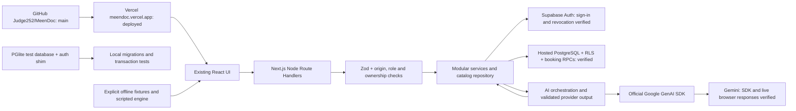

# MEENDOC architecture

Implementation checkpoint: 13 October 2026. This extends the approved Arabic RTL / English LTR frontend; installed versions are Next.js 16.4.0 and React 19.3.0. The application is a non-clinical demonstration with fictional providers and clinic bookings.

The approved project is `mofdzltldjwkalvkkbvk` in the MeenDoc organization. Its empty schema was inspected, the four migrations and seed applied, and migration versions recorded. Eleven hosted API/Auth/Postgres checks passed. Real Arabic preference extraction and an English Gemini-to-database result reached the browser. The English timeout was retried once with a 30-second timeout. See PROJECT_STATUS.md for all evidence and remaining limits.

## Modules and boundaries

| Module | Responsibility |
| --- | --- |
| `src/app/api/[...path]/route.ts`, `src/server/router.ts` | Dispatch HTTP methods to domain services; Node runtime and dynamic responses |
| `src/server/http.ts`, `src/lib/validation/schemas.ts` | Bounded input, origin checks, strict contracts, safe errors and request IDs |
| `src/lib/supabase`, `src/server/auth`, `src/proxy.ts` | HTTP-only SSR sessions, verified users, fresh database roles, protected pages |
| `src/server/services` | Accounts, booking, providers, applications, administration, matching and quotas |
| `src/server/repositories/catalog.ts` | Public/owned catalog joins, actual available slots, Cairo date formatting |
| `src/server/ai` | Provider interface, Gemini adapter, versioned prompts, safety boundary, preference normalization and response formatting |
| `supabase/migrations` | Schema, RLS, transactional booking, schedules and protected RPCs |
| `src/lib/api`, `src/lib/app-context.tsx` | Typed browser requests and temporary server-data cache |

Business writes in technical demo mode finish at the API/database before the UI reports success. `AppProvider` does not authorize direct persistent React-state mutations. Matching uses database filters; the model cannot select invented provider IDs or perform writes.

## Modes

- `APP_MODE=offline`: explicitly labeled original prototype; scripted chat, fictional local catalog and in-memory bookings/auth. No business API succeeds.
- `APP_MODE=demo`: API-backed fictional demonstration. Missing configuration or failed requests show unavailable states; there is no silent switch to fixtures.
- `LIVE_AI_ENABLED=false`: the database mode can use labeled scripted examples/manual search. Gemini requests require this flag, server credentials and consent.

The code default is offline when APP_MODE is absent. DEMO_SAFE_MODE must remain true.

## Request and state flow

Guest browsing and chat do not require sign-in. Protected actions use Supabase getUser(), current database roles and RLS. Database functions derive patient/actor IDs from the session rather than trusting request IDs.

The browser holds chat text only in memory and sends bounded context for each request. The private assistant table retains only preferences, consent version and a demonstration safety latch for 24 hours. Booking stores contact details and a database price snapshot, never a chat transcript.

Independent directory/notification reads are batched. Responses that depend on cookies use no-store/private caching. Session refresh is a proxy concern; authorization is repeated in services and PostgreSQL.

No extra backend service, Redis, queue, vector store, payment service or external analytics SDK was added.

The canonical Vercel production application passed 27 public HTTPS checks and eight controlled Auth/database workflows. All four privileged secrets are confined to Production server settings. SMTP is an external pending connection; signup/OTP/recovery delivery is not represented as a working edge in the diagram.
