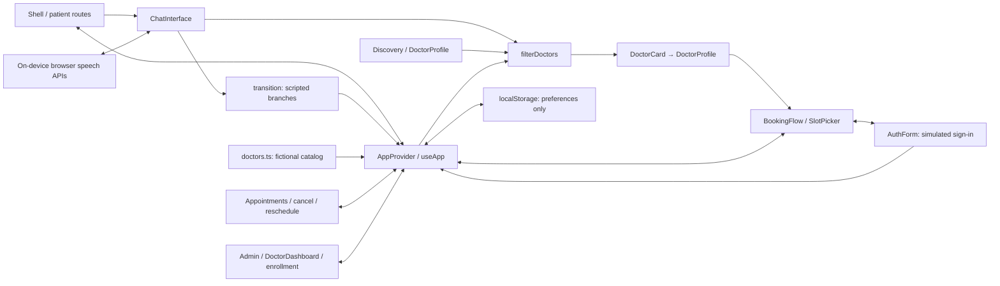

# MEENDOC MVP — Codebase Architecture Audit

Audit date: 2026-10-12. Scope: read-only inspection of application source, configuration, and tests. No application files were changed and no tests were executed. Runtime behavior and live deployment remain **UNKNOWN**.

Source paths below are relative to `D:\my  business\MEENDOC`.

## A. System Overview

**MeenDoc currently implements an interactive frontend prototype.** Its screens communicate through shared React state; there is no implemented application API, database, real authentication, or LLM integration.

Stack: Next.js App Router (installed **16.4.0**, declared `^16.0.0`), React 19.2, TypeScript, Tailwind CSS 4, custom CSS, and Lucide icons. Playwright and axe provide test coverage. Evidence: [`package.json`](../package.json).

The root [`src/app/layout.tsx`](../src/app/layout.tsx) wraps all routes with `AppProvider → Shell`. Client components handle business behavior. Server page wrappers pass route/query parameters to profile and booking components; they do not fetch patient or doctor data.

Arabic RTL is the default; English switches text and document direction.

## B. Component Map

“Working” means implemented local behavior, not verified production operation.

| Component / routes | Responsibility; input → output; connections | Source | Status |
|---|---|---|---|
| `Shell`, navigation, reusable UI | Route/language/state → header, footer, mobile navigation, dialogs, notices, toasts, loading/error states | `src/components/layout/app-shell.tsx`, `src/components/ui/primitives.tsx` | WORKING UI |
| `AppProvider`, `useApp` | `patch`/reducer actions → shared doctors, conversation, user, appointments, applications, preferences | `src/lib/app-context.tsx` | WORKING local state |
| `/`, `ChatInterface` | Starter choices/text → conversation transitions, scripted messages, matching cards; connects voice and preference controls | `src/app/page.tsx`, `src/components/assistant/chat-interface.tsx` | MOCK assistant |
| `transition` | Conversation/action → next phase, specialty, preferences, messages; uses translated response keys | `src/lib/conversation-engine.ts`, `src/lib/i18n.ts` | MOCK AI logic |
| `VoiceControl`, playback | Browser microphone → editable transcript → composer; assistant text → local speech synthesis | `src/components/assistant/voice-control.tsx`, `src/components/assistant/chat-interface.tsx` | PARTIAL; browser dependent |
| `/doctors`, preferences | URL search/filter parameters → filtered/sorted cards; shared matcher also serves chat/profile | `src/components/doctors/discovery.tsx`, `src/components/doctors/preferences-form.tsx`, `src/lib/mock-service.ts` | WORKING on mock data |
| Doctor records, cards, `/doctors/[id]` | Doctor ID/state → profile, services, match explanation, dates, booking link; favorites and comparison use context | `src/data/doctors.ts`, `src/components/doctors/doctor-card.tsx`, `src/components/doctors/doctor-profile.tsx` | MOCK catalog |
| `/booking/[doctorId]` | Doctor/date/time, demo user, patient fields → confirmed appointment in context | `src/components/booking/booking-flow.tsx`, `src/components/booking/slot-picker.tsx` | MOCK booking |
| Login/register/OTP/recovery | Form values → simulated user or recovery message; booking can embed the same form | `src/components/auth/auth-form.tsx`; `src/app/{login,register,otp,forgot-password}/page.tsx` | MOCK authentication |
| Account/favorites/appointments | Context → settings, saved doctors, appointment tabs; cancellation/rescheduling → context updates | `src/app/account/page.tsx`, `src/app/favorites/page.tsx`, `src/app/appointments/page.tsx` | WORKING demo UI |
| Doctor enrollment/dashboard | Form → pending application; selected doctor → profile/slot edits and appointment display | `src/app/join-as-doctor/page.tsx`, `src/app/doctor/dashboard/page.tsx`, `src/components/doctors/doctor-editor.tsx` | MOCK management |
| `/admin` | Context → counts, doctor/specialty visibility, application review, appointment status, announcement; canned feedback | `src/app/admin/page.tsx` | MOCK; unrestricted |

## C. Patient Journey

1. **Open `/`:** `HomePage` renders the welcome screen and `ChatInterface`. `AppProvider` supplies a fresh conversation and seeded doctors.
2. **Enter text/voice:** Text submission recognizes only exact translated starter phrases. Other text invokes `transition({type:"free", text})`, producing an uncertainty message. Voice, when supported, fills the composer after transcript review; the user still submits it.
3. **Process message:** `ChatInterface.act()` calls `transition()` locally and delays the UI update by **450 ms**. The typing indicator represents this timer. **No model call occurs.**
4. **Recommend specialty:** Selecting an eyes, skin, or joint example maps directly to ophthalmology, dermatology, or orthopedics. Duration choices advance the flow; they do not change the recommendation. Routine proceeds to preferences; urgent switches to the emergency branch.
5. **Match doctors:** Preference submission sets phase `results`. `filterDoctors(doctors, conversation.preferences)` performs the connection to doctor records: exact specialty/location/gender filters, fee limit, timing, and day offset. Default ordering is earliest offset, then lowest fee. Chat displays up to six results.
6. **Open profile:** Cards pass the doctor ID and `?from=assistant`. `DoctorProfile` resolves the record from context. Its match explanation additionally checks that the doctor still satisfies current conversation filters. Availability is seven generated dates plus a repeated slot list.
7. **Book:** The profile passes date/time in the booking URL. `BookingFlow` runs clinic → date → time → demo sign-in → patient details → review. It validates selections and checks collisions against current in-memory appointments.
8. **Confirm/manage:** Confirmation creates an `MD-…` reference and appends an appointment to context. `/appointments` can reschedule or cancel it. **No clinic receives the booking; refresh loses it.**

The frontend never crosses into an application backend. The “AI-to-doctor” connection is the local specialty field consumed by the shared matcher.

Route adapters: `src/app/doctors/[id]/page.tsx` and `src/app/booking/[doctorId]/page.tsx`. Core functions and components are identified in the component map above.

## D. Architecture Diagram

There is no database or external AI/API node because no such connection is implemented.

## E. Integrations & Data

- **APIs:** No `route.ts` handlers, Server Actions, application `fetch`/Axios requests, middleware, or proxy authorization were found. Next.js serves pages/assets; profile and booking wrappers await route parameters.
- **Data model:** `src/types/index.ts` defines `Doctor`, `Preferences`, `Patient`, `Appointment`, and `DoctorApplication`. These are TypeScript interfaces, not database tables. `Appointment.doctorId` references a doctor; patient details are embedded. Applications have no account/profile relationship.
- **Catalog:** Sixteen fictional doctors, seven specialties, three governorates. Credentials, services, clinics, and schedules are illustrative. Evidence: `src/data/doctors.ts`, `src/components/doctors/doctor-profile.tsx`.
- **Persistence/privacy:** Only `lang`, favorite IDs, `location`, and `reminders` enter `meendoc.demo.preferences.v1` localStorage. Chats, users, bookings, applications, edits, and announcements remain in memory. No application transmission or logging of patient/chat content was found. Discovery filters/search appear in URLs. Evidence: `src/lib/app-context.tsx`, `src/components/doctors/discovery.tsx`.
- **Authentication:** Any six-digit OTP succeeds; passwords are checked only for length. No verified identity, session cookie, token, roles, ownership enforcement, or server authorization exists. Evidence: `src/components/auth/auth-form.tsx`, `src/app/admin/page.tsx`, `src/app/doctor/dashboard/page.tsx`.
- **AI and medical safety:** No prompts sent to a model, LLM provider/model, structured model outputs, or medical inference exist. Scripted emergency/uncertainty branches and disclaimers reside in `src/lib/conversation-engine.ts` and `src/lib/i18n.ts`; chat emergency presentation resides in `src/components/assistant/chat-interface.tsx`.
- **Voice:** Recognition requires browser support for local processing and an already available language pack. Playback selects a `localService` voice. Real microphone/transcription/playback success is **UNKNOWN**. Evidence: `src/components/assistant/voice-control.tsx`, `src/components/assistant/chat-interface.tsx`.
- **Other integrations:** Supabase, LLM providers/models, maps, SMS/email, payments, external analytics, and remote storage are **MISSING**. Reminder toggles send nothing; admin analytics count local records. Fonts and portraits use local assets. Evidence: `package.json`, `src/app/account/page.tsx`, `src/app/admin/page.tsx`, `src/app/globals.css`, `src/components/doctors/doctor-card.tsx`.
- **Environment/deployment:** No application integration environment variables are referenced. Test configuration references only `MEENDOC_TEST_URL`, `MEENDOC_TEST_BROWSER`, and `CI` in `playwright.config.ts`. Live hosting configuration/status is **UNKNOWN**. No environment values were inspected or displayed.

## F. Implementation Status

| Status | Meaning here |
|---|---|
| **WORKING** | Implemented navigation, localization, filtering, favorites/comparison, form validation, and local state updates |
| **MOCK** | AI conversation, doctor catalog, authentication, booking, enrollment approval, dashboards/feedback |
| **PARTIAL** | Browser-dependent voice; emergency handling confined to conversation; enrollment stops at status updates |
| **MISSING** | Backend, database, real identity/RBAC, LLM orchestration, durable reservations, notifications/payment |
| **UNKNOWN** | Current runtime/test results, actual voice availability, production deployment |

The UI explicitly labels the prototype and fictional data; these mocks are disclosed. Existing journey tests (`tests/meendoc.spec.ts`) and accessibility tests (`tests/accessibility.spec.ts`) were inspected, not rerun.

## G. Top 5 Issues & Next Steps

1. **No durable booking or shared availability.** Reservations and collision checks exist only within one browser state; reload/logout removes appointments. Introduce authoritative server validation, database persistence, and atomic slot reservations before accepting real bookings. Evidence: `src/lib/app-context.tsx`, `src/components/booking/booking-flow.tsx`, `src/components/booking/slot-picker.tsx`.
2. **No access control.** `/admin` and `/doctor/dashboard` are publicly reachable; any visitor can select/edit any demo doctor. Implement verified authentication, roles, ownership checks, and server authorization before connecting real records. Evidence: `src/components/auth/auth-form.tsx`, `src/app/admin/page.tsx`, `src/app/doctor/dashboard/page.tsx`.
3. **Safety controls do not cover the full journey.** Emergency mode freezes chat and hides home recommendations, but doctor navigation/direct booking remains available. Free-text emergencies receive the generic uncertainty response. Establish clinician-reviewed handling across relevant flows before real patient testing. Evidence: `src/lib/conversation-engine.ts`, `src/components/assistant/chat-interface.tsx`, `src/app/page.tsx`, `src/components/layout/app-shell.tsx`, `src/components/booking/booking-flow.tsx`.
4. **Matching is limited and partly misleading.** Free text is not clinically interpreted; “subspecialty” repeats a specialty comparison. Matching ignores occupied slots, and the home carousel simply takes the first eight active doctors. Model real subspecialties and available inventory; distinguish browsing from medical recommendations. Evidence: `src/lib/conversation-engine.ts`, `src/lib/mock-service.ts`, `src/components/doctors/preferences-form.tsx`, `src/components/doctors/doctor-card.tsx`.
5. **Enrollment approval is a dead end.** Approval changes application status without creating/linking a doctor or account. The dashboard displays the latest application independently of the selected doctor. Add explicit application → verified account → doctor profile relationships and publication rules. Evidence: `src/app/join-as-doctor/page.tsx`, `src/app/admin/page.tsx`, `src/app/doctor/dashboard/page.tsx`.
